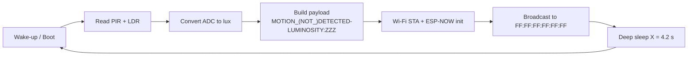
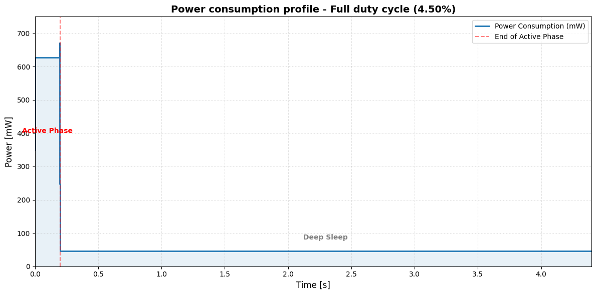
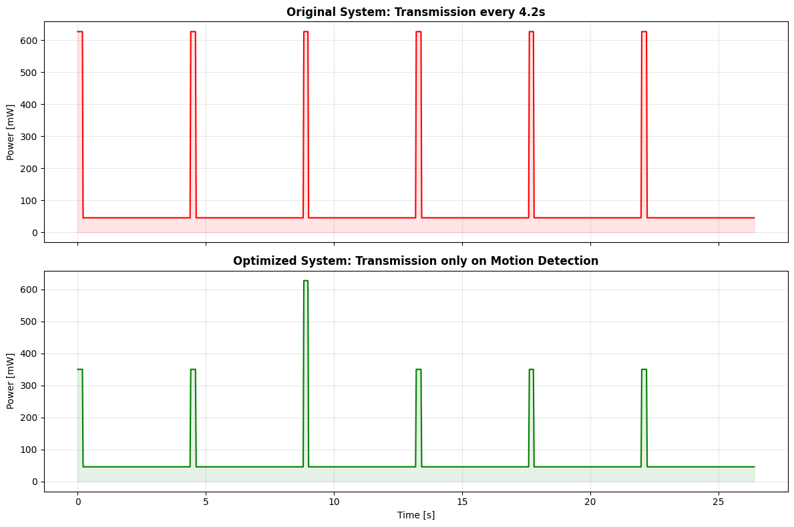
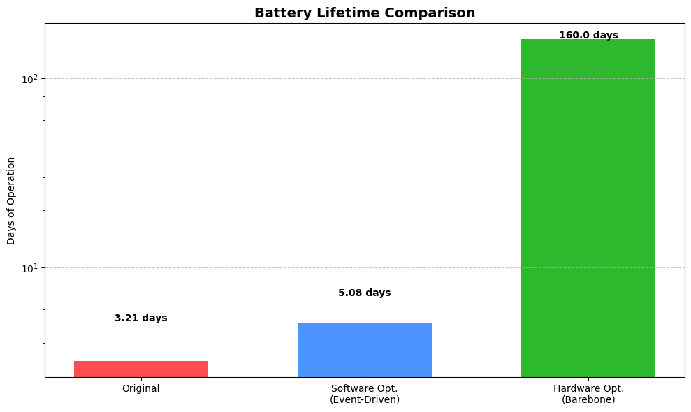
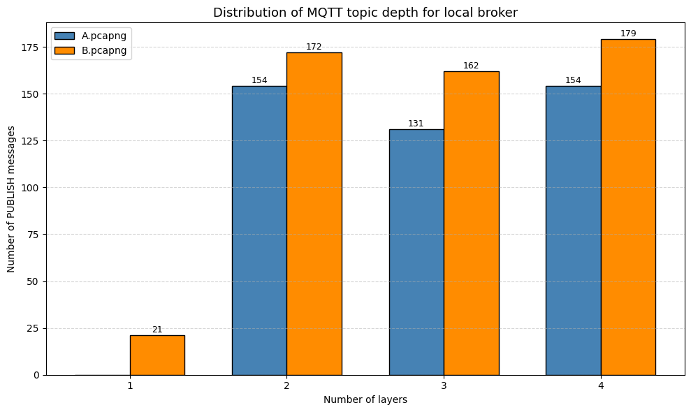
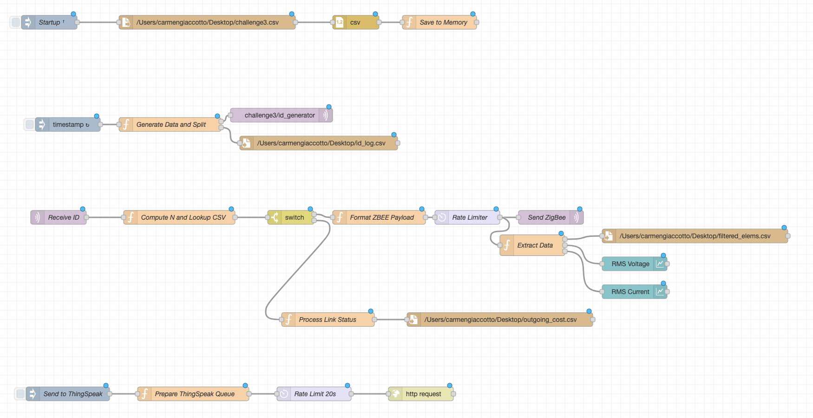
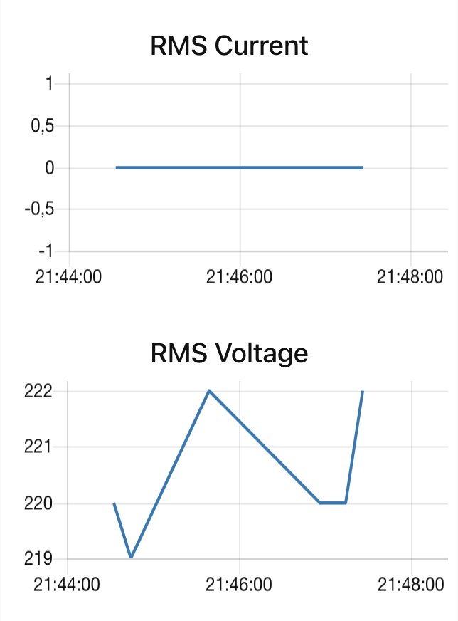
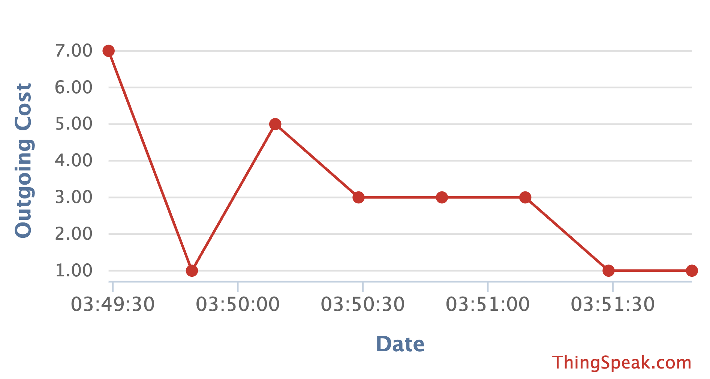
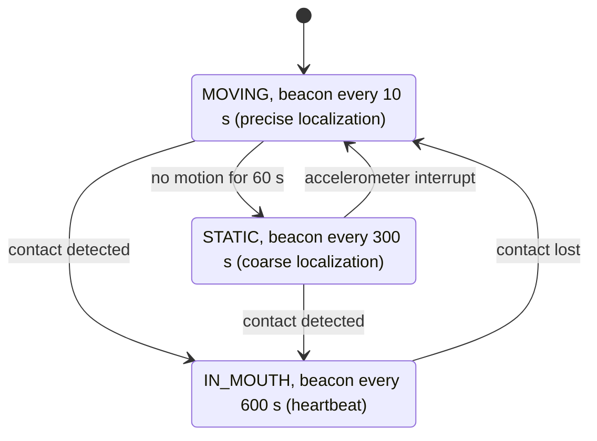
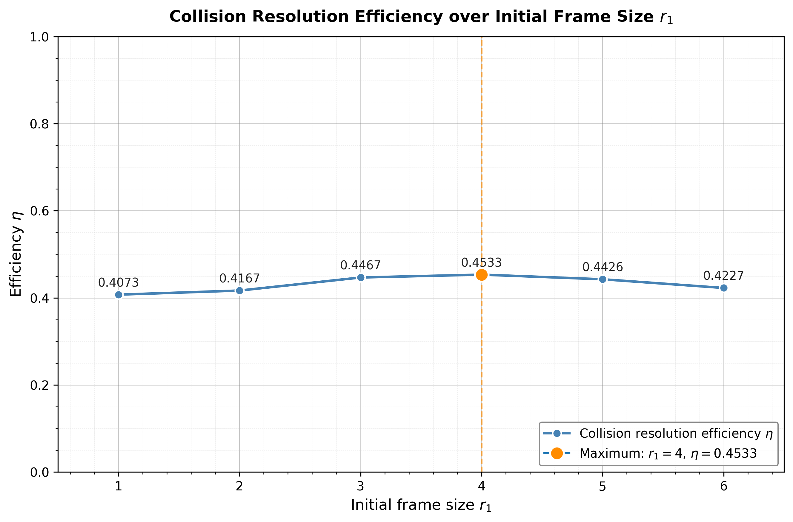

# Internet of Things – Challenges 2026

Solutions to the four challenges of the **Internet of Things** course (054323) at **Politecnico di Milano**, MSc in Computer Science and Engineering, A.Y. 2025/2026.

Each challenge has a hands-on part and a theoretical part. This repository contains the code, the datasets, the generated outputs and the PDF reports for each one.

| # | Topic | Tools | Main result |
|---|-------|-------|-------------|
| [1](#challenge-1--low-power-motion-sensor-with-esp32-and-esp-now) | Low-power motion sensor, ESP-NOW, energy estimation | ESP32, Wokwi, Arduino C++ | 315 mJ per cycle, about 3.2 days of battery life. With event-driven TX, about 5.1 days |
| [2](#challenge-2--packet-sniffing-coap-mqtt-mqtt-sn) | Packet sniffing: CoAP, MQTT, MQTT-SN | Wireshark, Python (pyshark, matplotlib) | 8 traffic-analysis questions answered and a topic-depth histogram |
| [3](#challenge-3--node-red-pipeline-and-lorawan) | Data pipeline with MQTT and ThingSpeak, LoRaWAN dimensioning | Node-RED, Mosquitto, ThingSpeak | 200-message ZigBee processing flow and a public ThingSpeak channel |
| [4](#challenge-4--ieee-802154-ble-localization-rfid) | IEEE 802.15.4 superframe, BLE beaconing, RFID anti-collision | Analytical modelling, Python | 4.1 % duty cycle, 93.7 % BLE energy saving, best RFID frame size r₁ = N |

**Authors:** Carmen Giaccotto, Alessia Franchetti-Rosada

---

## Repository structure

```
.
├── Challenge1_IoT/                     # ESP32 motion sensor + energy analysis
│   ├── Report.pdf                      # Report
│   ├── ex1_Challenge1.zip              # Wokwi project: final sensor firmware
│   ├── ex2_simulation_Challenge1.zip   # Wokwi project: instrumented version (timing with micros())
│   ├── ex3_improved_Challenge1.zip     # Wokwi project: energy-optimized firmware
│   ├── sender.csv                      # Power trace: ESP-NOW transmission (provided)
│   ├── deep_sleep.csv                  # Power trace: boot / Wi-Fi / deep sleep (provided)
│   └── sensor-read.csv                 # Power trace: sensor reading (provided)
│
├── Challenge2_IoT/                     # Packet sniffing
│   ├── Challenge.pdf                   # Report, Part 1 (CQ1–CQ8, Wireshark filters)
│   ├── Exercise.pdf                    # Report, Part 2 (CoAP vs MQTT energy)
│   ├── A.pcapng, B.pcapng              # Network captures (provided)
│   └── generateHistogram.ipynb         # Python notebook for CQ8 (topic-depth histogram)
│
├── Challenge3_IoT/                     # Node-RED + LoRaWAN
│   ├── Challenge.pdf                   # Report, Part 1 (Node-RED flow)
│   ├── Exercise.pdf                    # Report, Part 2 (LoRaWAN)
│   ├── nodered.txt                     # Node-RED flow export (JSON)
│   ├── challenge3.csv                  # ZigBee traffic dataset (provided)
│   ├── id_log.csv                      # Output: generated IDs
│   ├── filtered_elems.csv              # Output: RMS current / voltage / active power attributes
│   └── outgoing_cost.csv               # Output: ZigBee link costs
│
├── Challenge4_IoT/                     # Theoretical homework
│   ├── Exercise1.pdf                   # Report: IEEE 802.15.4 beacon-enabled network
│   ├── Exercise2.pdf                   # Report: BLE localization system redesign
│   └── Exercise3.pdf                   # Report: RFID Dynamic Frame ALOHA
│
├── img/                                # Figures used in this README (taken from the reports)
└── README.md
```

Every PDF is one of our reports, with every derivation and design choice explained. The sections below summarize them. Files marked *(provided)* are datasets supplied by the course instructors.

---

## Challenge 1 – Low-power motion sensor with ESP32 and ESP-NOW

> Full report: [`Challenge1_IoT/Report.pdf`](Challenge1_IoT/Report.pdf)

### Goal
Build, in the Wokwi emulator, a commercial-style smart-home sensor node. The node detects human motion and measures ambient light, then sends both to a central **sink node**, which decides whether to turn the room lights on. The node runs on a duty cycle and goes into **deep sleep** between measurements. The task also asks for an estimate of the node's energy use and battery life, and for improvements that reduce consumption.

### Hardware (Wokwi)
| Component | Pin | Notes |
|-----------|-----|-------|
| ESP32 DevKit-C v4 | – | MCU with integrated Wi-Fi |
| PIR motion sensor | GPIO 13 | Digital input. This GPIO does not affect the boot strapping pins |
| Photoresistor (LDR) | GPIO 34 | On **ADC1**, because ADC2 is shared with the Wi-Fi driver and gives unreliable readings while the radio is on |

### Firmware logic
Each wake-up runs the whole cycle inside `setup()`. `loop()` is empty because the ESP32 restarts from `setup()` after deep sleep.



- The sleep time comes from the team leader's person code: **X = (37 mod 50 + 5) / 10 = 4.2 s**.
- The battery energy is computed the same way: **Y = 9837 mod 5000 + 15000 = 19 837 J**.

There are three versions of the firmware, each one a complete Wokwi project (`sketch.ino` + `diagram.json`):

| Archive | Purpose |
|---------|---------|
| `ex1_Challenge1.zip` | Clean final firmware that meets the specification |
| `ex2_simulation_Challenge1.zip` | Instrumented with `micros()` to time each phase (sensing, Wi-Fi setup, TX). We used it to measure 20 cycles with the emulator at 100 % speed |
| `ex3_improved_Challenge1.zip` | Energy-optimized firmware (see below) |

### Energy estimation
The timings come from the instrumented Wokwi runs (mean of 20 cycles). The average power of each state comes from steady-state windows in the provided CSV power traces.

| State | Duration | Avg. power | Energy |
|-------|----------|-----------|--------|
| Sensor reading | 1.05 ms | 350 mW | 0.37 mJ |
| Wi-Fi / ESP-NOW setup | 196.1 ms | 627 mW | 122.95 mJ |
| Transmission (TX) | 69.8 µs | 671 mW | 0.05 mJ |
| Idle / logic | 0.69 ms | 247 mW | 0.17 mJ |
| Deep sleep | 4.2 s | 45.6 mW | 191.52 mJ |
| **Total cycle** | **4.398 s** | | **315.06 mJ** |

**Battery lifetime:** 19 837 J / 0.315 J ≈ 62 963 cycles, which is **≈ 276 905 s (≈ 3.2 days)**.

The bottlenecks are the deep sleep baseline (about 61 % of the energy, because the DevKit has an LED, a USB-UART bridge and an LDO that stay powered) and the Wi-Fi start-up at every cycle (about 39 %).



### Improvements
1. **Event-driven transmission (software).** The previous motion state and lux value are kept in `RTC_DATA_ATTR` memory, which survives deep sleep. On wake-up the node reads the sensors and **turns on Wi-Fi only if something changed**: the motion state flipped, or the light level moved by more than 50 lux.
2. **TX power reduction (software).** `WiFi.setTxPower(WIFI_POWER_2dBm)` lowers the TX power from about 671 mW to about 621 mW, which is enough for an indoor room.
3. **Hardware choice (design).** A bare ESP32 module (or an ESP32-C3) instead of a DevKit brings deep sleep from 45.6 mW down to about 10 µW.

If the room state changes in 5 % of the cycles, the average energy per cycle drops to **≈ 198.2 mJ**, which gives **≈ 5.08 days** of battery life (about +60 %). Adding the hardware change brings it to **over 160 days**.




> Wokwi does not reliably keep `RTC_DATA_ATTR` variables across deep sleep, so the emulated optimized node may still transmit at every cycle. The code is correct for real ESP32 hardware.

### Theoretical exercise – energy trade-off in a WSN
Linear topology: presence sensor → 3 Philips Hue bulbs → sink, D = 40 m, k = 2000 bit, E_c = 300 nJ/bit, ε = 1 nJ/bit/m².

| Strategy | Total network energy | Energy spent by the battery-powered sensor |
|----------|---------------------|-------------------------------------------|
| Direct (1 hop, 40 m) | **4 400 µJ** | 3 800 µJ |
| Multi-hop (4 hops, 10 m) | **5 600 µJ** | 800 µJ |

**Choice: multi-hop.** It minimizes the **maximum per-node energy**. The relaying work moves to the mains-powered bulbs, and the battery-powered sensor uses about 4.75× less energy, so the network lasts longer even though the total energy is higher.

### Running it
1. Create a new **ESP32** project on [wokwi.com](https://wokwi.com).
2. Unzip one of the archives and paste `sketch.ino` and `diagram.json` into the project.
3. Start the simulation and open the Serial Monitor. Move the PIR slider and the LDR lux slider to change the payload.

---

## Challenge 2 – Packet sniffing (CoAP, MQTT, MQTT-SN)

> Full reports: [`Challenge2_IoT/Challenge.pdf`](Challenge2_IoT/Challenge.pdf) (Part 1) · [`Challenge2_IoT/Exercise.pdf`](Challenge2_IoT/Exercise.pdf) (Part 2)

### Part 1 – Traffic analysis of `A.pcapng` and `B.pcapng`
The assignment asks 8 questions (CQ1–CQ8) about the CoAP, MQTT and MQTT-SN traffic in two captures. Each answer was found with Wireshark display filters and checked by hand. The report lists every filter and the reasoning behind each answer.

| Q | Question (short) | Answer | How |
|---|------------------|:------:|-----|
| CQ1a | NON DELETE requests to `coap.me` with a successful response | **MID 30800** | `coap && ip.dst == 134.102.218.18 && coap.type == 1 && coap.code == 0.04` returns 20 requests. Matching tokens with the responses leaves only `/validate`, which got `2.02 Deleted` |
| CQ1b | How many actually achieved the deletion | **0** | A later GET on `/validate` still returns `2.05 Content`, so the resource was never deleted |
| CQ2 | Local resources with as many failed CON POST as failed CON PUT (X = Y > 0) | **1** | Per-resource count of 4.xx/5.xx responses matched by MID or token. Only `/dining_room` has X = Y = 1 |
| CQ3a | Separate Observe notifications for `/dining_room/temperature` | **10** | Token `89b9`. The piggybacked first response is excluded, and duplicate MIDs (retransmissions) are dropped |
| CQ3b | Useless notifications | **5** | From MID 54 on, the client answers with *ICMP Port Unreachable*. RFC 7641 §4.5 says the server must then drop the observer, but it keeps sending |
| CQ4 | MQTT-SN messages received by clients from the broker on port 1885 | **0** | All 219 MQTT-SN Publish messages (QoS −1) are followed by *ICMP Port Unreachable*: no broker is listening on that port |
| CQ5 | Subscribers that receive a Last Will through a wildcard subscription | **1** | Will topic `university/department12/room1/temperature` on `::1` matches only `university/#` |
| CQ6a | Clients that cleared a retained message on HiveMQ | **5** | PUBLISH with `retain=1` and an empty payload, found with *Follow TCP Stream* on each of the 9 HiveMQ clients |
| CQ6b | Of those, clients whose Client ID is longer than 7 bytes | **2** | `giuxfijwus` (10 B) and `rolsmcwhshlbc` (13 B) |
| CQ7 | SUBSCRIBE requests to the local broker with at least 2 wildcards | **9** | `mqtt.msgtype == 8 && ipv6.dst == ::1`, counting every `+` and `#` |
| CQ8 | PUBLISH messages to the local broker, by topic depth | **A: 439 · B: 534** | Python script (below) |

#### CQ8 script – `generateHistogram.ipynb`
The notebook uses **pyshark** (a Python wrapper around `tshark`) to keep only the PUBLISH messages sent to the local broker on port 1883 (`127.0.0.1` in A, `::1` in B). It computes each topic's depth as `len(topic.split('/'))` and plots a grouped histogram with matplotlib.



To run it, install `tshark` (part of Wireshark) and `pip install pyshark nest_asyncio matplotlib`. The notebook was written on Google Colab, so change the paths `/content/sample_data/*.pcapng` to point at the files in this folder.

### Part 2 – CoAP vs MQTT energy
A battery-powered temperature sensor sends one reading every 2 minutes to a battery-powered fan actuator. They talk either directly over CoAP or through a mains-powered MQTT gateway (E_TX = 50 nJ/bit, E_RX = 58 nJ/bit).

| | Protocol flow | Energy over 1 h (sensor + actuator) |
|-|---------------|-------------------------------------|
| **EQ1a – CoAP** | CON PUT (70 B) + ACK (15 B), 30 times | **2 203.2 µJ** |
| **EQ1b – MQTT** | One-time CONNECT/CONNACK/SUBSCRIBE/SUBACK, then PUBLISH + PUBACK on both sides, 30 times | **3 385.92 µJ** |

**EQ2 – the actuator now wakes up only every 30 min.** We chose **MQTT with `retain = 1`, `QoS = 1`, `clean session = 1`**. With CoAP CON, every PUT sent while the actuator sleeps goes unacknowledged and is retransmitted (RTO = 30 s, MAX_TRANSMISSIONS = 3), and the data is lost anyway. With MQTT, the broker keeps the last value, so the actuator connects, receives the retained message and disconnects. Metric optimized: **total energy consumption, i.e. battery lifetime**.

---

## Challenge 3 – Node-RED pipeline and LoRaWAN

> Full reports: [`Challenge3_IoT/Challenge.pdf`](Challenge3_IoT/Challenge.pdf) (Part 1) · [`Challenge3_IoT/Exercise.pdf`](Challenge3_IoT/Exercise.pdf) (Part 2)

### Part 1 – Node-RED flow
The flow (`nodered.txt`) processes a ZigBee traffic dataset (`challenge3.csv`, 5 218 packets). The data moves through a local Mosquitto broker and ends up on a public ThingSpeak channel.



The flow has five blocks:

| Block | What it does |
|-------|--------------|
| **0 · Memory init** | On deploy, reads `challenge3.csv`, parses it and stores the rows in `global.csvData`, so later lookups do not touch the disk |
| **1 · ID generator** | Once per second, publishes `{"id": rand(0..30000), "timestamp": <unix>}` to `challenge3/id_generator` (`localhost:1884`) and appends a row to `id_log.csv`, up to 200 rows |
| **2 · Subscriber & lookup** | Subscribes to the same topic, stops hard after **exactly 200 messages**, computes **N = id mod 5218** and fetches the packet with that number |
| **3 · Routing** | A `switch` node on `Command String` sends `ZBEE_ZCL` packets one way and `Link Status` packets the other. Anything else is dropped but still counts toward the 200 |
| **4 · ZBEE_ZCL branch** | Builds the JSON payload (addresses as hex), publishes to `ZigBee/<DeviceName>` through a **10 msg/min** rate limiter, then pulls out *Active Power*, *RMS Current* and *RMS Voltage*, pairing each attribute with its status, type and value by list position. The rows go to `filtered_elems.csv` and to two dashboard charts |
| **5 · Link Status branch** | Parses the link list and updates a `linkCosts[src][dst]` map (a later packet overwrites older values), then rewrites `outgoing_cost.csv`. A manual inject then takes the **smallest source address**, sorts its destinations in hex order and sends each cost to **ThingSpeak** (`field1`) at **1 message every 20 s** |

**Results**
- `id_log.csv`: 200 generated IDs.
- `filtered_elems.csv`: 30 attribute rows from 10 qualifying packets.
- `outgoing_cost.csv`: 70 links from 9 ZigBee sources. The smallest source is `0x0000`, and its 8 costs (rows 63–70) were uploaded to ThingSpeak.

<p float="left">
  
  
</p>

#### Running the flow
1. Start a broker on the required port: `mosquitto -p 1884`
2. In Node-RED, install **`node-red-dashboard`** (Manage palette), then use *Import* to load `nodered.txt`.
3. Change the paths in the *file* / *file in* nodes (they point to `/Users/.../Desktop/`) to your own `challenge3.csv` and output folder.
4. In the *http request* node, replace the `api_key` with the **Write API key of your own ThingSpeak channel**.
5. Deploy. After the 200 messages, click **Send to ThingSpeak** to upload the costs.

### Part 2 – LoRaWAN dimensioning
40 nodes send 20-byte packets (33 bytes with the LoRaWAN header and MIC) at λ = 2 pkt/min each, on 868 MHz / 125 kHz. The aggregate rate is Λ = 4/3 pkt/s.

**EQ1.** We model the network as pure ALOHA: P_s = e^(−2G) with G = Λ·T_air. The requirement P_s ≥ 75 % gives G ≤ 0.1438.

| SF | Airtime (TTN calculator) | P_s |
|----|--------------------------|-----|
| **7** | 71.9 ms | **82.5 % ✓** |
| 8 | 133.6 ms | 70.0 % ✗ |
| 9 | 246.8 ms | 51.8 % ✗ |
| 10–12 | ≥ 452 ms | < 30 % ✗ |

The largest SF that meets the requirement is **SF7**.

**EQ2.** When success rates differ a lot from node to node, the cause is the **link budget** (path loss, SNR), not collisions, because collisions hurt every node about equally. The right action is **moving the nodes closer to the gateway**. Raising the SF would increase airtime and collisions, and having fewer nodes would not fix the asymmetry.

---

## Challenge 4 – IEEE 802.15.4, BLE localization, RFID

> Full reports: [`Exercise1.pdf`](Challenge4_IoT/Exercise1.pdf) · [`Exercise2.pdf`](Challenge4_IoT/Exercise2.pdf) · [`Exercise3.pdf`](Challenge4_IoT/Exercise3.pdf)

### Exercise 1 – Vibration monitoring on IEEE 802.15.4 (beacon-enabled, CFP only)
Each node counts vibration peaks in a 10 s window (Poisson, λ = 0.4) and sends 512 B, 2 KB or 4 KB (4, 16 or 32 packets of 128 B) when it sees 0, 1 or more than 1 peaks. R = 250 kbps, 1 PAN coordinator, 3 nodes.

| Quantity | Value |
|----------|-------|
| P(r = r₀), P(r = r₁), P(r = r₂) | **0.6703**, **0.2681**, **0.0616** |
| Beacon interval BI = L / r_min | 1024 bit / 409.6 bps = **2.5 s** (4 BIs per reporting window) |
| GTS slots per node per BI | worst case 32 packets / 4 BIs = **8** |
| Slot time T_s | 1024 bit / 250 kbps = **4.096 ms** |
| N_slots in the CFP | 3 × 8 = **24** (plus 1 beacon slot = 25 active slots) |
| T_active / T_inactive | **102.4 ms** / **2 397.6 ms** |
| Duty cycle | **0.041 (4.1 %)** |
| Extra nodes with DC < 10 % | (1 + 8N)·T_s < 250 ms gives N ≤ 7, so **4 more nodes** (DC = 9.34 %) |

### Exercise 2 – BLE localization of dental prostheses
The original firmware sends a BLE beacon every 10 s, all day. Our redesign starts from one observation: **a denture that is being worn cannot be lost**. The beacon rate therefore follows a context-aware state machine.



- **Sensors:** a TI **FDC1004** capacitive sensor detects whether the denture is in the mouth (10 µA in standby, polled every 5 s). An ST **LIS2DH12** accelerometer detects motion (2 µA at 1 Hz) and raises a hardware interrupt.
- **Components:** Nordic **nRF52810** BLE SoC, powered by a Panasonic **CR2032** coin cell.
- **Assumed day:** 16 h in the mouth, 7 h static, 1 h moving. That is 8 h per day in which localization is needed.
- **Energy:** 15 µJ per beacon. The original design sends 8 640 beacons per day (129.6 mJ). The new one sends 540 (**8.1 mJ/day**), a saving of **≈ 93.7 %**.

### Exercise 3 – RFID with Dynamic Frame ALOHA (N = 4 tags)
We enumerated the backlog distribution for each initial frame size r₁, then applied the recursion L_total(r₁) = r₁ + Σ P(b) · L_b (with L₂ = 4, L₃ = 51/8 and L₄ ≈ 8.824 derived from them). The efficiency is η = N / L_total.

| r₁ | 1 | 2 | 3 | **4** | 5 | 6 |
|----|---|---|---|---|---|---|
| L_total | 9.824 | 9.600 | 8.954 | **8.824** | 9.038 | 9.466 |
| η | 0.4073 | 0.4167 | 0.4467 | **0.4533** | 0.4426 | 0.4227 |



The maximum is at **r₁ = N = 4**. A smaller frame causes many collisions and large leftover backlogs. A larger frame wastes slots that stay empty.

---

## Technologies

- **Hardware and emulation:** ESP32, Wokwi, Arduino framework, ESP-NOW, deep sleep, RTC memory
- **Protocols:** CoAP (CON/NON, Observe), MQTT and MQTT-SN (QoS, retain, Last Will, wildcards), ZigBee / ZCL, LoRaWAN, IEEE 802.15.4, BLE, RFID
- **Tools:** Wireshark, Python (pyshark, matplotlib), Node-RED and node-red-dashboard, Mosquitto, ThingSpeak, Google Colab

## Authors

| Name |
|------|
| **Carmen Giaccotto** |
| **Alessia Franchetti-Rosada** |

## Notes

- The assignment slides are not included, because they belong to the course instructors. Each section above summarizes what the challenge asked.
- The datasets marked *(provided)* (power traces, `.pcapng` captures, `challenge3.csv`) were supplied by the course instructors at Politecnico di Milano. They are included only so the results can be reproduced.
